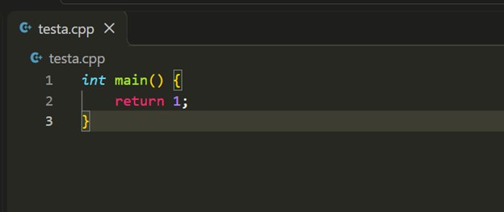
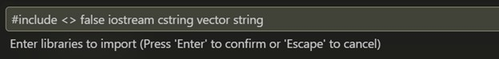
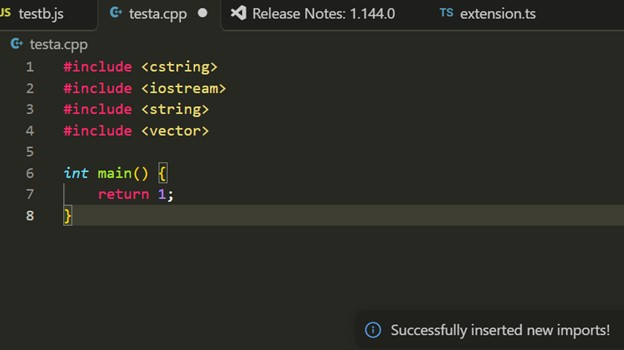

Данный проект выполнен студентом ИТМО Мелехином Алексеем Александровичом из группы M3114

# Плагин import-extension
Данный репозиторий является плагином для **Visual Studio Code**, который добавляет команду для вставки импортов нескольких библиотек в алфавитном порядке после их перечисления пользователем.

# Использование плагина
1. Для использования плагина, нажмите **Ctrl + Shirt + P**, после чего выполните команду `Import Libraries`.
2. Введите первым словом оператор для импорта библиотек который использует ваш язык программирования.
3. Вторым "словом" являются операторы, который ставятся вокруг названий библиотек в вашем языке.
* Первым символом должен быть левый оператор.
* Вторым символом должен быть правый оператор.
* Если язык не использует такие операторы, то напишите `nil`.
4. Третьим словом должно быть `true` или `false`.
* `true` - Плагин будет ставить `;` после каждого импорта.
* `false` - Плагин не будет ставить `;` после импортов.
5. Далее через пробел перечисляются библиотеки, которые должны быть добавлены.

Каждая новая вставка появляется в начале файла в алфавитном порядке.

# Пример использования.
В качестве ввода используем `#include <> false iostream cstring vector string` в файле расширения .cpp.
## Перед выполнением команды:

## После выполнения команды:

